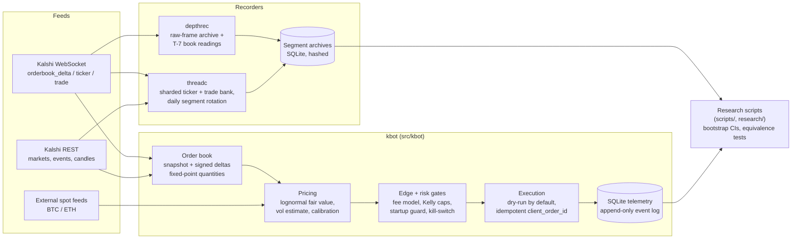

# Kalshi Research Platform

A Python market-data and trading research platform for [Kalshi](https://kalshi.com)
prediction markets, built around **pre-registered statistical testing**. It
streams order books over Kalshi's WebSocket API, maintains them incrementally,
prices contracts, gates orders through fee-aware edge and risk checks, and logs
everything to SQLite. Separate recorders bank raw exchange frames so that
research hypotheses can be evaluated against data, under rules fixed before
anyone looks at the results.

> **No profitable edge is claimed.** The research documents in this repo record
> hypotheses that were tested and killed, and one that is still unresolved. See
> [Research results](#research-results). Dry-run is the default, and nothing
> here is financial advice.

## Architecture



| Package | Role |
|---|---|
| `src/kbot/` | Trading engine: auth (RSA-PSS), REST and WS clients, order book, strategies, fee/edge model, risk, execution, paper trading, backtesting, telemetry, calibration/learning loop, CLI |
| `src/depthrec/` | Research recorder for the favorite-longshot study: canonical book, raw-frame archive, independent census, pinned classifier, dual-stream equivalence tests |
| `src/threadc/` | Long-running recorder that banks raw `ticker` and `trade` messages across an append-only market universe, sharded across connections, rotating archives at 00:00 UTC |
| `scripts/` | Data pulls, analyses, probes, and recorder entry points |
| `research/` | Pre-registered protocols, amendments, and reproducible reconstruction scripts |
| `deploy/`, `docs/` | systemd unit and operations and cloud-deployment notes |

## Testing approach

**1,869 tests** across 71 test modules (`tests/`). The latest full run in this
public mirror (Python 3.11, Windows, 60 s per-test timeout):
**1,843 passed, 26 skipped, 0 failed**. Every skip is explicit and conditional:
- 21 need historical econ-release CSVs (`tests/conftest.py`).
- 3 compare files against the pre-registered frozen commit in git history
  (`tests/conftest.py`).
- 2 need the preserved equivalence-probe evidence database (existing `skipif`
  markers).

None of that material ships in this mirror.

- **Network-free.** Exchange sessions, REST clients, and clocks are replaced by
  in-process fakes (`tests/threadc_fakes.py`), and RSA keys are generated in
  memory per test. The suite needs no credentials.
- **Regression tests pin real wire shapes.** Book handling is tested against
  the exchange's actual V2 delta shape and fixed-point string quantities,
  including the truncation cases that motivated `kbot.quantity`.
- **Safety properties are tested structurally.** Dry-run places nothing, the
  startup guard fails closed on ambiguous configuration, and AST-level
  isolation tests check that the recorders cannot reach an order path. The
  `threadc` recorder never imports the order-capable client, and its HTTP
  layer is GET-only behind a read allowlist (`test_threadc_isolation.py`,
  `test_depthrec_isolation.py`, `test_research_isolation.py`).
- **Frozen parameters are hash-pinned.** Pre-registered constants and
  classifier fixtures are checked against recorded SHA-256 hashes
  (`src/depthrec/pinned_hashes.py`), so a silent edit to a frozen rule fails
  the suite.
- **Async code is tested directly** with `pytest-asyncio` (auto mode).

## Notable engineering problems

**Frozen order book from a delta-schema mismatch.** The original delta handler
assumed deltas had the same shape as snapshots and rebuilt the same level list
on every message. The book never moved, and from the logs a frozen book looked
exactly like a quiet market. `scripts/capture_delta.py` recorded the real V2 shape
(one signed level: `price_dollars` / `delta_fp` / `side`), `runner._apply_delta`
was rewritten against it, and `scripts/verify_delta_fix.py` proves the fix on
live data by feeding deltas through the runner's own functions and requiring
the best bid, best ask, and mid to change. Deltas with an unrecognised shape are now
rejected and counted, not silently absorbed.

**Event-loop starvation.** Several best-effort paths made blocking calls on the
asyncio loop that consumes the WebSocket:
- A Google Sheets telemetry write made synchronous HTTPS round trips and slept
  on 429 backoff. It now latches off after the first non-retryable error
  (`src/kbot/sheets.py`).
- The research recorder's census and classifier called the SDK synchronously,
  and the SDK's rate limiter sleeps.
- The raw-frame archive ran ~424 SQLite inserts per second on the loop.

Every blocking call now runs in `asyncio.to_thread`. The raw writer
(`src/depthrec/rawwriter.py`) reduces the loop's share to taking a lock and
appending to a list, and leaves hashing, compression, and the INSERTs to one
worker thread, with backpressure instead of dropped frames.

**Fixed-point quantities.** Kalshi's V2 API sends quantities as two-decimal
strings (`"0.50"`, `"-104.00"`). Parsing them with `int(float(x))` truncates
toward zero, so a half-contract level read as empty and a delta of `-104.5` left
phantom size in the book forever, because an incremental book never washes the
error out. `src/kbot/quantity.py` stores every quantity as an exact integer
count of hundredths of a contract, with a mandatory `*_units` naming convention.

**Fail-closed startup guard.** Every existing safety check was series-blind, and
some ran per signal, after the live client already existed.
`src/kbot/startup_guard.py` refuses to build an order-capable engine unless the
effective series and `DRY_RUN` resolve unambiguously, and it never allows the
unvalidated ETH strategy outside dry-run. It raises on ambiguity and never falls
back to dry-run quietly.

**Streaming evaluator memory fix.** The pre-registered equivalence evaluator
decoded an entire raw-frame archive into per-stream, per-market event lists
before evaluating anything. On the first formal run that reached about 5.54 GB of
anonymous RSS, and the 5.8 GB VM OOM-killed it. Only two quantities are actually
global: the archive-wide cutoff timestamp and the connection-boundary instants.
Everything else is scoped to a single market. The evaluator in
`src/depthrec/equivalence_v2.py` now reads the archive twice:
- Pass 1 keeps only the globals and an on-disk `market -> row id` index.
- Pass 2 decodes, evaluates, and drops one market at a time.

Peak RSS on the two formal archives fell to 392 MiB and 532 MiB (4.4M and 6.4M
frames). `scripts/depthrec_market_sizes.py` checks whether that scaling matches
the largest single market. The semantics had to be unchanged, so the replaced
loader is kept verbatim as a test fixture (`tests/frozen_v2_reference.py`).
`tests/test_depthrec_v2_streaming.py` runs every fixture through both
evaluators and compares the complete results field by field.
`scripts/depthrec_v2_regression.py` re-evaluated both formal archives and
matched their committed frozen verdicts on all 18 top-level fields. Procedure:
[`docs/S8V2_STREAMING_REGRESSION.md`](docs/S8V2_STREAMING_REGRESSION.md).

## Research results

The governing document is [`KILL_CRITERIA.md`](KILL_CRITERIA.md), which was
written and committed before the tests it governs were run. Its standing rules
include: no threshold or window changes after seeing output, one look per test,
mandatory out-of-sample checks, fees *and* spread on every EV number, and "if a
result implies free money, it is a bug until proven otherwise."

As recorded in this repository:

- **Killed before pre-registration (five hypotheses):** lag, direction
  prediction, market miscalibration, cross-venue arbitrage, and an ETH-specific
  edge.
- **Thread B (slow-crypto news response): FAIL on both hypotheses.** Over 106
  price shocks, the median Kalshi mid move was 0.00¢ out to +60 minutes. All
  70 high-confidence Kalshi/Polymarket pairs failed resolution equivalence,
  because the two venues settle on different sources and currencies, so the
  apparent gaps are prices of different contracts.
- **Thread A (favorite-longshot rule): not passed, unresolved.** For the
  pre-registered rule (buy the favorite at ≥ 0.70, seven minutes before close),
  the corrected estimate is +1.28¢ per contract with a 95% CI of about
  [−0.18¢, +2.68¢]. The interval straddles zero, so the pre-registered PASS bar
  is not met. A procedural failure (an in-sample sweep that re-derived the
  threshold) is recorded in the amendments instead of being discarded.
- **Threads C and D:** this repository contains their protocols and the Thread C
  recording infrastructure. It records no verdict for either.

## Running the tests

Requires Python ≥ 3.11.

```bash
python -m venv .venv
source .venv/bin/activate        # Windows: .venv\Scripts\activate
pip install -e ".[dev]"
pytest -q
```

No API keys are needed for the test suite. Running the bot against Kalshi
needs `KALSHI_KEY_ID` and `KALSHI_PRIVATE_KEY_PATH` in the environment (see
`src/kbot/config.py`), and it runs in dry-run mode unless live trading is
explicitly enabled through several independent gates.

## Note

Public mirror of a private repository developed July–Sep 2026; built with
Claude Code, with architecture, testing methodology, deployment, and debugging
by Michael Nguyen. Raw market data, recorded archives, and credentials are not
included; some documents cite data files that exist only in the private
repository.
